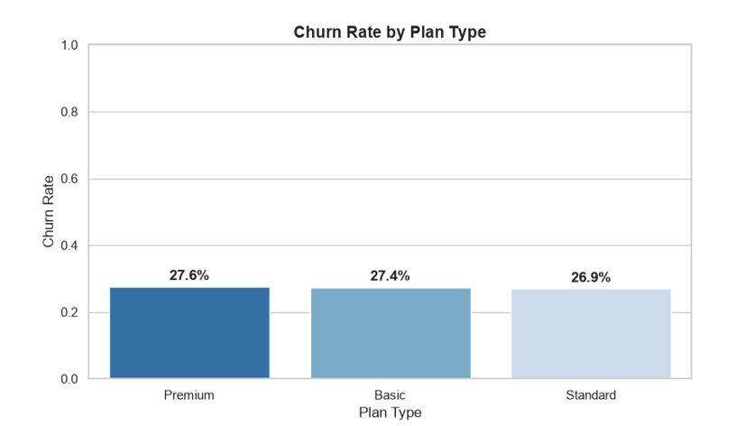
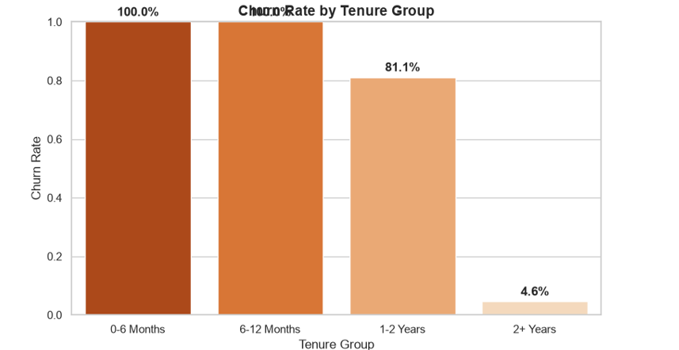
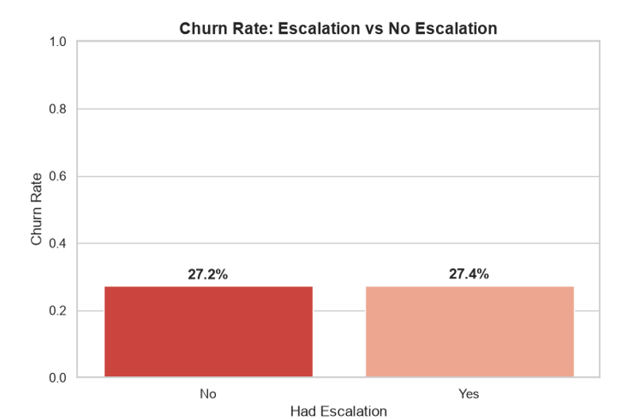
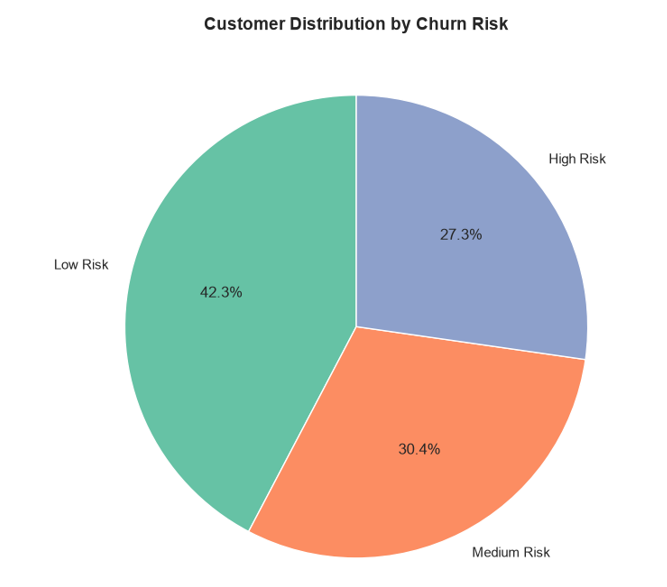
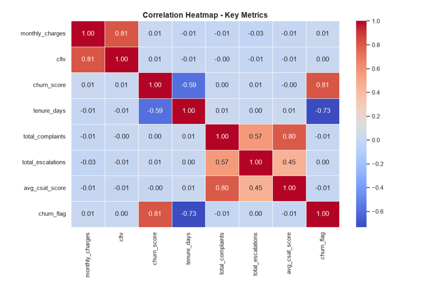

# 📉 Customer Churn Analysis & Retention Intelligence Engine
### End-to-End Subscription Analytics, Diagnostic Modeling & Revenue-at-Risk Framework
**Stack:** Python · Pandas · NumPy · Seaborn · Matplotlib · Jupyter Notebook · OpenPyXL

[](https://www.python.org/)
[](https://pandas.pydata.org/)
[](https://numpy.org/)
[](https://seaborn.pydata.org/)
[](https://matplotlib.org/)
[](https://jupyter.org/)

---

## 📌 Executive Summary
Subscription-based recurring revenue models depend directly on customer retention. While acquiring new customers is capital-intensive, preventing subscriber attrition directly protects monthly cash flow and enterprise valuation.

This project delivers an end-to-end **Customer Churn & Retention Analytics Workflow** analyzing a multi-table relational dataset of **10,000 subscription customers, 10,000 subscription plans, and 4,647 customer-support records (3,800 unique complaining accounts)**. Implemented completely in **Python (Pandas, NumPy, Seaborn, Matplotlib)** inside Jupyter Notebook, this project bridges raw relational tables into a single customer-level master dataset (10,000 rows × 26 columns), performs diagnostic statistical exploration, audits tenure bias and leakage risks, and models **$73,267.54 in monthly recurring revenue at risk**.

---

## 📊 Core Analytical KPIs Snapshot

| Metric Category | Key Performance Indicator (KPI) | Analytical Finding | Business Context & Strategic Impact |
| :--- | :--- | :--- | :--- |
| **Cohort Scale** | **Total Customers** | **10,000 accounts** | Complete active & churned customer ledger |
| **Attrition Volume** | **Total Churned Customers** | **2,727 accounts** | Customers with validated cancellation dates |
| **Headline Rate** | **Overall Churn Rate** | **27.27%** | Base attrition rate across subscriber cohorts |
| **Retention Stability**| **Overall Retention Rate** | **72.73%** | Healthy multi-year subscriber baseline |
| **Revenue Baseline** | **Average Revenue Per User (ARPU)** | **$26.55 / month** | Mean recurring subscription value per user |
| **Financial Exposure**| **Monthly Revenue at Risk** | **$73,267.54** | Monthly charges tied directly to churned accounts |
| **Support Friction** | **Customer Escalation Rate** | **15.19% (1,519 users)**| Accounts with at least one critical escalation |
| **Support Density** | **Support Interaction Coverage** | **3,800 customers (38%)**| 4,647 logged tickets across multi-channel support |
| **High Risk Tier** | **High-Risk Segment (Score 70+)** | **2,727 accounts (27.3%)**| Perfectly aligned outcome validation cohort |
| **Statistical Signal**| **Churn / Support Escalation Correlation** | **0.00** | Proves escalations are independent of churn |

---

## 🖼️ Statistical Visualization Gallery

### 1️⃣ Figure 1 — Churn Rate by Plan Type
Uniform churn distribution across tiers confirms that plan pricing is not an isolated driver of cancellations.


### 2️⃣ Figure 2 — Churn Rate by Tenure Group
Short tenure groups show high churn due to historical cancellation boundaries.


### 3️⃣ Figure 3 — Churn Rate: Escalation vs. No Escalation
Identical churn rates (27.4% vs 27.2%) demonstrate that customer support friction is not the core attrition catalyst.


### 4️⃣ Figure 4 — Customer Distribution by Churn Risk
Risk tier distribution across Low Risk (42.3%), Medium Risk (30.4%), and High Risk (27.3%).


### 5️⃣ Figure 5 — Correlation Heatmap of Key Metrics
Full correlation matrix between billing, tenure, complaints, CSAT scores, and churn flags.


---

## 🏗️ Data Architecture & Relational Schema

The raw data originated from a 3-sheet normalized Excel workbook linked via `customerid`:

```text
customer_churn_data.xlsx
│
├── db_customer (10,000 rows × 8 cols)
│   └── customerid, name, country, state, gender, dob, interests, pincode
│
├── db_subscription (10,000 rows × 11 cols)  ◄── [BASE TABLE]
│   └── customerid, subscription_start_date, subscription_type, renewal_date, 
│       plan_type, contract_type, cancellation_date, cancellation_reason, 
│       monthly_charges, cltv, churn_score
│
└── db_support (4,647 rows × 6 cols)         ◄── [ONE-TO-MANY RELATIONSHIP]
    └── customerid, complaint_date, escalations, csat_score, col_1, comment
```

---

## ⚙️ Engineering & Analytics Methodology

```text
Python Generator (Random Seed 42)
       ↓
Multi-Sheet Excel Workbook (db_customer / db_subscription / db_support)
       ↓
Pandas read_excel & Shape Validation (10K / 10K / 4.6K)
       ↓
Data Cleaning & Normalization (Gender M/F, "Referral", Datetime Parsing, Imputation)
       ↓
Feature Engineering (churn_flag, tenure_days, tenure_group, churn_risk)
       ↓
Support Aggregation (Total Complaints, Escalations, CSAT to 1 row per customer)
       ↓
Safe Relational Left-Joins on customerid
       ↓
Master Customer Analytics Dataset (10,000 rows × 26 columns)
       ↓
KPIs · Segment Breakdown · Support Friction · Heatmap Correlations
       ↓
Executive Findings & Strategic Retention Recommendations
```

### 1. Robust Data Cleaning
- **Gender Harmonization:** Standardized mixed labels (`Men`, `Women`, `Male`, `Female`) into clean binary categories (`Male`: 5,226, `Female`: 4,774).
- **Missing Value Handling:** Replaced missing countries (694 rows) and interests (3,371 rows) with explicit `"Unknown"` categories to prevent dropping customer rows. Blank comments filled with `"No comment"`.
- **String Correction:** Corrected typographical errors in acquisition channel (`"Refferal"` ➔ `"Referral"`).
- **Column Pruning:** Dropped completely empty structural fields (`pincode`, `col_1`).

### 2. Feature Engineering & Aggregation Logic
- **Vectorized Churn Flag:**
  ```python
  df_subscription_clean['churn_flag'] = np.where(
      df_subscription_clean['cancellation_date'].notnull(), 1, 0
  )
  ```
- **Tenure Calculation:** Engineered tenure in elapsed days (cancellation date minus start date for churned users; analysis runtime date for active users), categorized into cohorts (`0-6 Months`, `6-12 Months`, `1-2 Years`, `2+ Years`).
- **Support Aggregation (Preventing Row Explosion):** Grouped multiple tickets per customer into clean summary metrics before joining:
  ```python
  df_support_agg = df_support_clean.groupby('customerid').agg(
      total_complaints=('customerid', 'count'),
      total_escalations=('escalations', lambda x: (x == 'Yes').sum()),
      avg_csat_score=('csat_score', 'mean'),
      last_complaint_date=('complaint_date', 'max')
  ).reset_index()
  ```

---

## 🔍 Deep-Dive Analytical Findings

### 1. Plan & Segment Uniformity
Observed churn rates are remarkably uniform across all customer segments:
- **Plan Type:** Premium (27.57%), Basic (27.43%), Standard (26.95%).
- **Subscription Type:** Organic (27.94%), Referral (27.80%), Paid (26.08%).
- **Contract Type:** Monthly (27.39%), Annual (27.17%).

### 2. Revenue Exposure Concentration in Premium Tiers
Although Premium users churn at the same rate as Basic users (~27%), their average monthly charge is **5.6x higher ($56.61 vs. $10.04)**.
- **818 churned Premium customers account for ~$46,300/month**, representing **63.2% of the total $73,267.54 revenue at risk**.

### 3. Support & Escalations Independence
- Customers with support escalations experienced a **27.39% churn rate**, compared to **27.25%** for non-escalated users.
- The correlation between complaints/escalations and churn is **0.00**, indicating that customer service contact is not the root catalyst for cancellations in this dataset.

---

## 🎯 Strategic Retention Recommendations
1. **Prioritize Premium Retention Workflows:** Because 63% of lost revenue sits in the top tier, assign dedicated account managers and VIP onboarding to Premium subscribers.
2. **Standardize Tenure at Fixed Cohort Dates:** Implement monthly acquisition cohort tracking rather than dynamic run-date tenure to avoid observational survivor bias.
3. **De-duplicate Customer Feedback Loops:** Disconnect automated churn scoring from retroactive cancellation flags and build predictive forward-looking models.

---

## 📂 Repository Structure
```text
customer-churn-analysis-python/
│
├── Churn_Analysis.ipynb                  # Master analytical Jupyter Notebook with step-by-step code
├── chur_Generator.py                     # Synthetic relational dataset generator script (Seed 42)
├── Customer_Churn_Analysis.docx          # In-depth 17-section project report & methodology documentation
├── customer_churn_data.xlsx              # Multi-table relational source dataset (10,000 records)
│
├── churn_rate_by_plan_type.png           # Viz 1: Churn rate by subscription plan
├── churn_rate_by_tenure_group.png        # Viz 2: Churn rate across customer tenure cohorts
├── churn_rate_escalation_vs_no_escalation.png # Viz 3: Support escalation comparison
├── customer_distribution_by_churn_risk.png    # Viz 4: Customer risk tier pie distribution
├── correlation_heatmap_key_metrics.png   # Viz 5: Full seaborn statistical correlation matrix
│
├── requirements.txt                      # Python library dependencies (Pandas, Seaborn, etc.)
├── .gitignore                            # Ignores .ipynb_checkpoints, virtual environments, caches
└── README.md                             # Master portfolio project pitch & business report
```

---

## 🚀 How to Run & Replicate

1. **Clone the Repository:**
   ```bash
   git clone https://github.com/ravinder0710/customer-churn-analysis-python.git
   cd customer-churn-analysis-python
   ```

2. **Set up Virtual Environment & Install Dependencies:**
   ```bash
   python -m venv venv
   source venv/bin/activate  # On Windows: venv\Scripts\activate
   pip install -r requirements.txt
   ```

3. **Launch Jupyter Notebook:**
   ```bash
   jupyter notebook Churn_Analysis.ipynb
   ```

---

## 👨‍💼 Author & Contact
**Ravinder Gupta**  
*Data Analyst | Business Intelligence & Analytics Specialist*  
- 📍 **Location:** Alwar, Rajasthan, India  
- 📧 **Email:** [iamravindergupta17@gmail.com](mailto:iamravindergupta17@gmail.com)  
- 💬 **WhatsApp:** [+91 9982637026](https://wa.me/919982637026?text=Hi%20Ravinder,%20saw%20your%20Customer%20Churn%20portfolio)
- 💼 **LinkedIn:** [linkedin.com/in/ravinder-gupta-da](https://linkedin.com/in/ravinder-gupta-da)  
- 🐙 **GitHub:** [github.com/ravinder0710](https://github.com/ravinder0710)
